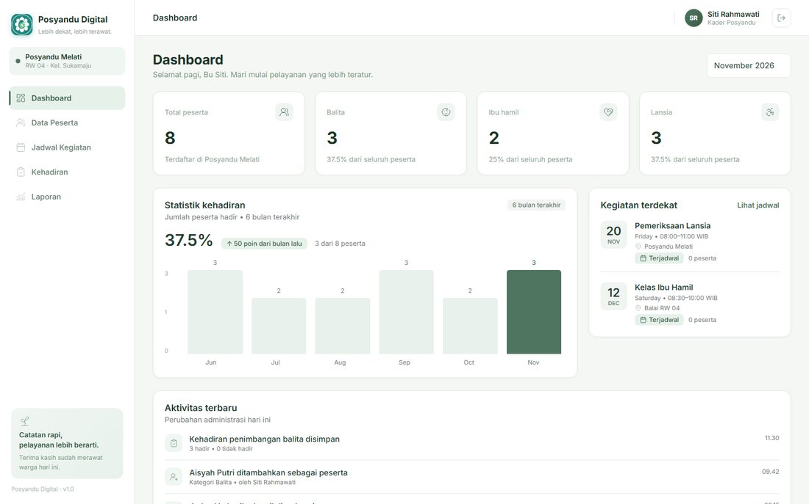
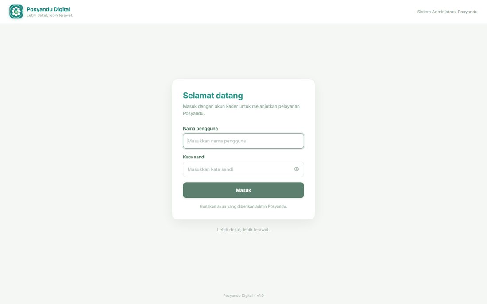
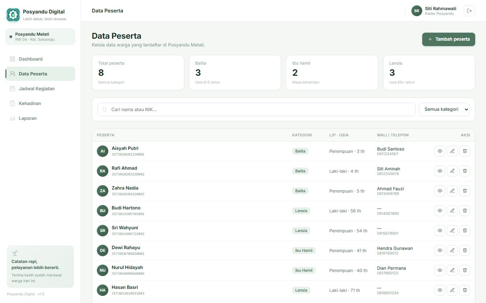
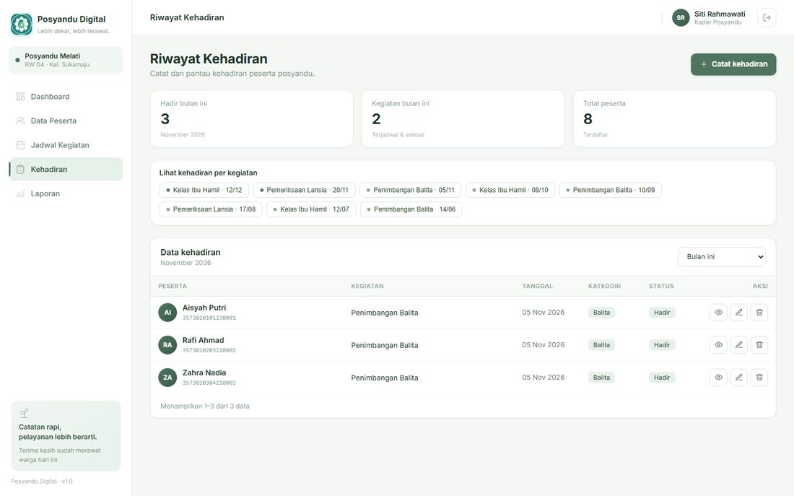

# Sistem Administrasi Posyandu

> Proyek Akhir mata kuliah Pemrograman Web — Kelas B
> Program Studi Teknologi Informasi, Fakultas Ilmu Komputer, Universitas Brawijaya

Aplikasi web untuk mengelola data posyandu — peserta, jadwal kegiatan, dan kehadiran — yang menggantikan pencatatan kertas menjadi satu basis data terpusat.



## Latar belakang

Mayoritas posyandu masih mencatat data di kertas. Kader menghabiskan hingga 40% waktu operasional hanya untuk merekap ulang data bulanan ke Puskesmas, data mudah hilang, dan tren tumbuh kembang anak tidak terpantau sehingga deteksi dini stunting sering terlambat.

Aplikasi ini memindahkan seluruh proses itu ke dalam sistem terpusat dengan pencatatan yang dirancang mengikuti cara kerja nyata kader di lapangan.

## Fitur

| Fitur | Keterangan |
|---|---|
| Login & Logout | Autentikasi kader dengan nama pengguna dan kata sandi; halaman administrasi tertutup bagi tamu |
| Dashboard | Ringkasan peserta per kategori, tren kehadiran enam bulan, kegiatan terdekat, aktivitas terbaru |
| Data Peserta | Daftar terpaginaasi dengan pencarian nama/NIK dan filter kategori (balita, ibu hamil, lansia) |
| Kelola Peserta | Tambah, detail, ubah, hapus melalui panel overlay dengan validasi NIK 16 digit unik |
| Jadwal Kegiatan | Daftar kegiatan dengan filter status/kategori; CRUD termasuk perubahan status |
| Catat Kehadiran | Pencatatan massal satu kegiatan untuk banyak peserta sekaligus |
| Riwayat Kehadiran | Filter periode (bulan berjalan, tiga bulan, semua) dan rekap per kegiatan |
| Laporan Tahunan | Kehadiran per bulan selama 12 bulan dan distribusi peserta per kategori |
| Log Aktivitas | Jejak audit setiap perubahan data beserta waktu dan pelaku |

**Keunggulan utama:** peserta yang tidak dicentang otomatis tercatat *tidak hadir*, sehingga penyebut laporan selalu benar. Seluruh aksi CRUD dilakukan lewat panel overlay tanpa berpindah halaman — pencatatan satu warga selesai di bawah 30 detik.

## Teknologi

- **Laravel** — kerangka kerja PHP dengan pola MVC, routing, Eloquent, migrasi, autentikasi sesi, validasi server-side
- **PHP** — logika aplikasi sisi server
- **MySQL** — basis data relasional utama
- **Blade + CSS + JavaScript** — tampilan responsif hingga lebar 720 px, grafik, dan panel overlay
- **PHPUnit** — 32 uji fungsional otomatis

## Menjalankan secara lokal

```bash
git clone https://github.com/Rafifrdz/sistem-administrasi-posyandu.git
cd sistem-administrasi-posyandu

composer install
cp .env.example .env
php artisan key:generate
```

Sesuaikan kredensial basis data pada `.env`:

```env
DB_CONNECTION=mysql
DB_HOST=127.0.0.1
DB_PORT=3306
DB_DATABASE=posyandu
DB_USERNAME=root
DB_PASSWORD=
```

Buat basis data lalu jalankan migrasi beserta data contoh:

```bash
mysql -u root -e "CREATE DATABASE posyandu CHARACTER SET utf8mb4 COLLATE utf8mb4_unicode_ci;"
php artisan migrate:fresh --seed
php artisan serve
```

Buka <http://127.0.0.1:8000>.

## Akun demo

| Nama pengguna | Kata sandi | Peran |
|---|---|---|
| `siti` | `posyandu123` | Kader Posyandu |
| `admin` | `admin123` | Administrator |

## Struktur basis data

| Tabel | Isi |
|---|---|
| `users` | Akun kader dan administrator |
| `peserta` | Data peserta posyandu beserta kategori dan data wali |
| `kegiatan` | Jadwal kegiatan: tanggal, jam, lokasi, kategori, status |
| `kehadiran` | Satu baris per peserta per kegiatan (hadir / tidak hadir) |
| `activity_log` | Jejak audit perubahan data |

## Tampilan

| Halaman Masuk | Data Peserta | Riwayat Kehadiran |
|---|---|---|
|  |  |  |

## Pengujian

```bash
php artisan test
```

32 uji fungsional, 131 asersi — mencakup CRUD peserta, kegiatan, kehadiran, serta autentikasi.

## Dokumentasi

- `KELOMPOK 6_LAPORAN PROJECT AKHIR_PAW.pdf` — laporan akhir sesuai template mata kuliah
- `PERBANDINGAN - Laporan Lama vs Laporan Baru.pdf` — perbandingan dengan dokumen analisis sebelumnya
- [Desain antarmuka di Figma](https://www.figma.com/design/A5CKXaB1DekO0Ykk4j5It1/POSYANDU)

## Tim

| Nama | NIM | Kontribusi |
|---|---|---|
| Muhammad Rafi Firdaus | 255150701111016 | Basis data, migrasi, model, pengendali, logika kehadiran, pengujian |
| Fanisah Wulandari | 255150700111027 | Antarmuka Figma, tampilan Blade, panel overlay, dashboard, laporan |
