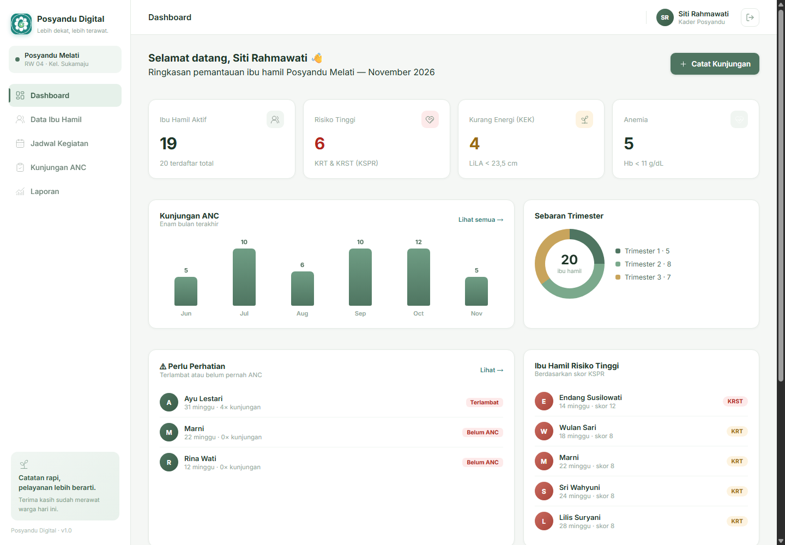
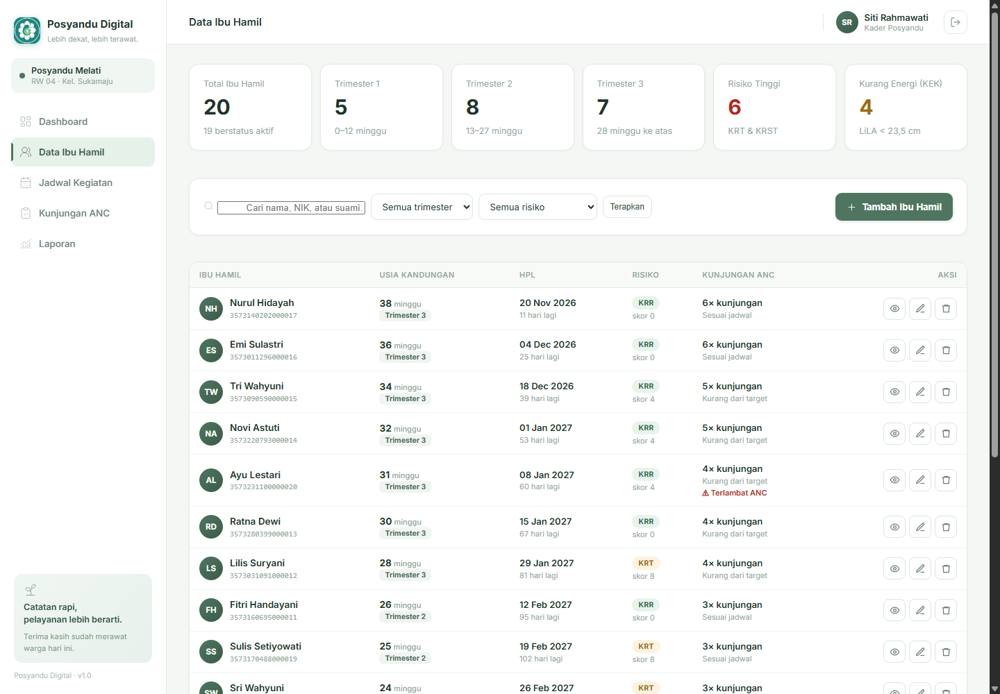
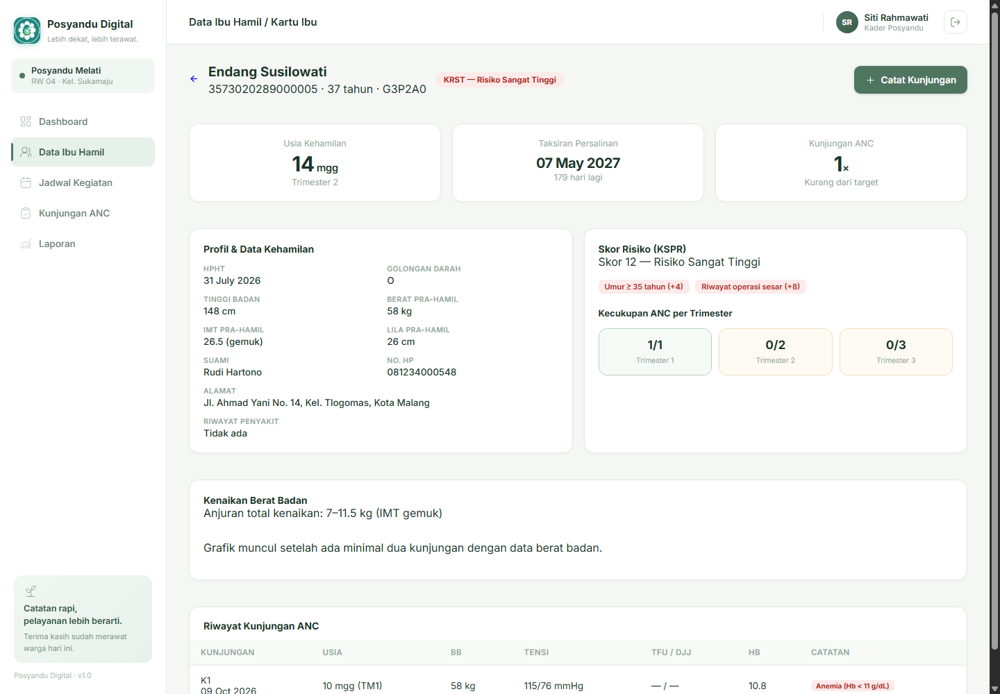
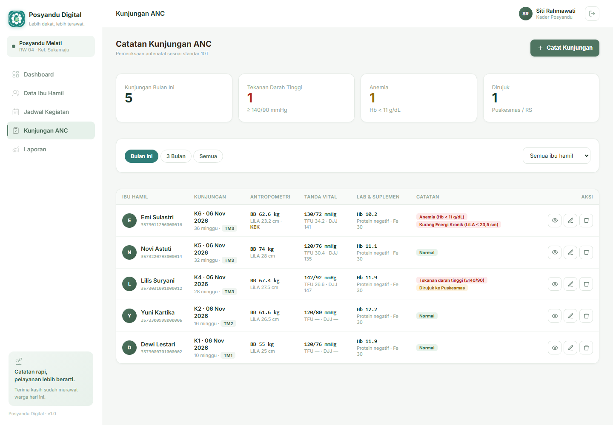
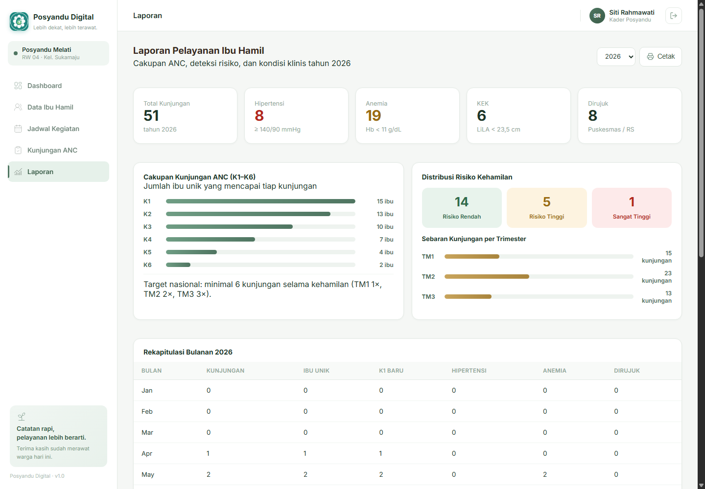

# Sistem Administrasi Posyandu — Fokus Ibu Hamil

> Proyek Akhir mata kuliah Pemrograman Web — Kelas B
> Program Studi Teknologi Informasi, Fakultas Ilmu Komputer, Universitas Brawijaya

Aplikasi web untuk memantau kehamilan di posyandu: mencatat data ibu hamil, menghitung usia kehamilan dan taksiran persalinan, menilai risiko kehamilan, serta merekam hasil pemeriksaan ANC sesuai standar 10T.



## Latar belakang

Posyandu adalah garda terdepan kesehatan ibu dan anak, tetapi pencatatannya masih dilakukan di atas kertas. Kader menghabiskan banyak waktu merekap ulang data ke Puskesmas, riwayat pemeriksaan ibu mudah hilang, dan deteksi dini kehamilan berisiko sering terlambat. Akibatnya intervensi stunting dan komplikasi persalinan tidak tepat waktu.

Aplikasi ini memindahkan seluruh proses itu ke satu basis data terpusat, dengan alur kerja yang mengikuti prosedur posyandu yang sebenarnya.

## Dasar acuan

Sistem ini tidak mengarang aturan sendiri — semua perhitungan dan alur mengikuti standar Kementerian Kesehatan:

| Acuan | Isi |
|---|---|
| **ANC 6×** (Permenkes 21/2021) | Kunjungan antenatal minimal 6 kali: TM1 1×, TM2 2×, TM3 3× |
| **10T** (Permenkes 21/2021 Ps. 13) | BB/TB, tensi, LiLA, TFU, presentasi & DJJ, imunisasi TT, tablet Fe ≥90, lab, tata laksana, konseling |
| **KSPR** | Kartu Skor Poedji Rochjati untuk menilai risiko kehamilan (KRR / KRT / KRST) |
| **Buku KIA** | Instrumen pencatatan ibu hamil yang dipakai kader di lapangan |

## Fitur

| Fitur | Keterangan |
|---|---|
| Login & Logout | Autentikasi kader/bidan; seluruh halaman administrasi tertutup bagi tamu |
| Dashboard | Ringkasan bumil aktif, sebaran trimester, bumil risiko tinggi, KEK, anemia, tren kunjungan 6 bulan, dan daftar yang terlambat ANC |
| Data Ibu Hamil | Daftar dengan pencarian nama/NIK/suami, filter trimester dan kategori risiko |
| Pendaftaran Ibu Hamil | Form lengkap: identitas, HPHT, GPA, antropometri pra-hamil, riwayat obstetri |
| Kartu Ibu | Halaman detail: usia kehamilan, HPL, skor KSPR beserta faktornya, kecukupan ANC per trimester, grafik kenaikan berat badan, riwayat kunjungan |
| Jadwal Kegiatan | Pemeriksaan ANC rutin, kelas ibu hamil, USG, kunjungan rumah, skrining — dengan sasaran trimester |
| Kunjungan ANC | Pencatatan 10T lengkap; usia kehamilan dan kode K1–K6 dihitung otomatis |
| Peringatan Klinis | Otomatis menandai hipertensi (≥140/90), anemia (Hb <11), KEK (LiLA <23,5), DJJ abnormal, proteinuria |
| Laporan | Cakupan K1–K6, rekap bulanan, distribusi risiko, daftar ibu risiko tinggi, siap cetak |
| Log Aktivitas | Jejak audit setiap perubahan data |

### Perhitungan otomatis

- **Usia kehamilan** — `floor((hari ini − HPHT) / 7)` minggu
- **Taksiran persalinan** — HPHT + 280 hari (rumus Naegele)
- **Trimester** — ≤12 minggu TM1 · 13–27 TM2 · ≥28 TM3
- **IMT pra-hamil** — BB / (TB/100)²
- **Skor KSPR** — 10 faktor ibu + 4 faktor temuan kunjungan → KRR ≤4 · KRT 6–10 · KRST ≥12
- **Status ANC** — dibandingkan dengan target kumulatif per trimester

## Teknologi

- **Laravel 12** — MVC, routing, Eloquent, migrasi, autentikasi sesi, validasi server-side
- **PHP 8.4** — logika aplikasi dan perhitungan kebidanan
- **MySQL** — basis data relasional utama
- **Blade + CSS + JavaScript** — tampilan responsif hingga 720 px, grafik SVG, panel modal
- **PHPUnit** — 46 uji otomatis (157 asersi)

## Menjalankan secara lokal

```bash
git clone https://github.com/Rafifrdz/sistem-administrasi-posyandu.git
cd sistem-administrasi-posyandu

composer install
cp .env.example .env
php artisan key:generate
```

Sesuaikan kredensial basis data pada `.env`:

```env
DB_CONNECTION=mysql
DB_HOST=127.0.0.1
DB_PORT=3306
DB_DATABASE=posyandu
DB_USERNAME=root
DB_PASSWORD=
```

```bash
mysql -u root -e "CREATE DATABASE posyandu CHARACTER SET utf8mb4 COLLATE utf8mb4_unicode_ci;"
php artisan migrate:fresh --seed
php artisan serve
```

Buka <http://127.0.0.1:8000>.

## Akun demo

| Nama pengguna | Kata sandi | Peran |
|---|---|---|
| `siti` | `posyandu123` | Kader Posyandu |
| `bidan` | `bidan123` | Bidan Desa |
| `admin` | `admin123` | Administrator |

Data contoh berisi 20 ibu hamil pada berbagai trimester, 10 jadwal kegiatan, dan 51 catatan kunjungan ANC — termasuk kasus risiko rendah, tinggi, sangat tinggi, KEK, anemia, dan hipertensi.

## Struktur basis data

| Tabel | Isi |
|---|---|
| `users` | Akun kader, bidan, dan administrator |
| `ibu_hamil` | Data sasaran: identitas, HPHT, GPA, antropometri pra-hamil, riwayat obstetri, skor KSPR |
| `kegiatan` | Jadwal layanan: jenis, sasaran trimester, lokasi, status |
| `kunjungan_anc` | Satu baris per pemeriksaan: 10T lengkap + tanda bahaya + tindak lanjut |
| `activity_log` | Jejak audit perubahan data |

## Tampilan

| Data Ibu Hamil | Kartu Ibu | Kunjungan ANC |
|---|---|---|
|  |  |  |

| Dashboard | Laporan |
|---|---|
|  |  |

## Pengujian

```bash
php artisan test
```

46 uji otomatis, 157 asersi — mencakup CRUD ibu hamil, pencatatan kunjungan ANC, perhitungan usia kehamilan/HPL/IMT, penilaian skor KSPR, deteksi peringatan klinis, dan autentikasi.

## Dokumentasi

- `KELOMPOK 6_LAPORAN PROJECT AKHIR_PAW.pdf` — laporan akhir sesuai template mata kuliah
- `PERBANDINGAN - Laporan Lama vs Laporan Baru.pdf` — perbandingan dengan dokumen analisis sebelumnya
- [Desain antarmuka di Figma](https://www.figma.com/design/A5CKXaB1DekO0Ykk4j5It1/POSYANDU)

## Tim

| Nama | NIM | Kontribusi |
|---|---|---|
| Muhammad Rafi Firdaus | 255150701111016 | Basis data, migrasi, model, layanan perhitungan kehamilan & KSPR, pengendali, pengujian |
| Fanisah Wulandari | 255150700111027 | Antarmuka Figma, tampilan Blade, panel modal, dashboard, laporan |
